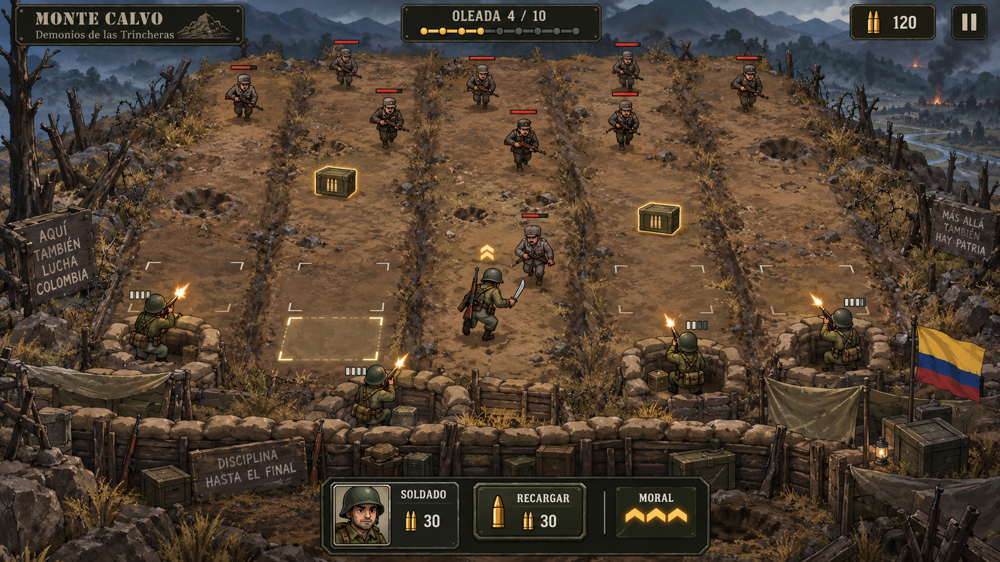

# Referencia visual aprobada — Monte Calvo

## Procedencia y alcance

Concepto generado en este chat y aceptado por la persona antes de solicitar la primera iteración del terreno y las trincheras. Es una propuesta de dirección artística, no una captura del prototipo. La copia conserva los bytes de la imagen original.

- Archivo: `monte-calvo-concept.png`, 1672 × 941 píxeles.
- SHA-256: `bafdb75592277f1da742fa0dbcf5e57d209116b8d12f17166efd82918a3c8142`.
- La copia está en la documentación de la feature; `.gdignore` mantiene este directorio fuera del escaneo de recursos de Godot y de la exportación automática. No es un recurso del nivel.

## Elementos que se trasladan a esta iteración

| Rasgo observado | Adaptación al nivel actual | Criterio de revisión |
|---|---|---|
| Tierra ocre y sombras oliva | Suelo continuo, con variaciones suaves | Centro legible; textura subordinada a los actores provisionales |
| Montañas frías y neblina | Horizonte ilustrado estático azul grisáceo | Profundidad pintada, sin cámara ni niebla dinámica |
| Ladera de aspecto pictórico | Pincelada y materiales coherentes | Sin pixel art, fotorrealismo o acabado 3D brillante |
| Tierra excavada y madera | Segmentos de trinchera en la zona de defensa y marco | Encajan con posiciones existentes; no elevan ni desplazan actores |
| Sacos de arena | Refuerzos decorativos de silueta clara | Siempre detrás de actores y pickups; no representan cobertura |
| Bordes más detallados | Rocas y hierba seca limitadas al marco visual | No dibujan una frontera mecánica ni bloquean interacción |

## Elementos excluidos

Cinco carriles, casillas iluminadas/selección nueva, soldados y enemigos del concepto, nuevas animaciones, cajas de munición rediseñadas, HUD, botones, retratos, carteles, bandera, explosiones, efectos y humo animado. La imagen muestra valores y acciones que no sustituyen los datos reales del juego.

No se proyecta el tablero en perspectiva ni se escala la lógica para copiar la composición. La profundidad se dibuja en los recursos visuales. Las posiciones y las reglas actuales prevalecen sobre la ubicación de cualquier objeto en la imagen.

## Revisión artística futura

Comparar capturas del mismo estado antes/después, junto a esta referencia. Revisar por separado paleta, materiales, fondo, terreno y trincheras; después comprobar lectura de los actores provisionales, ocupación y recolección. Registrar observaciones concretas en la evidencia de la feature. La preparación documental no certifica que exista ya esa comparación del juego.
