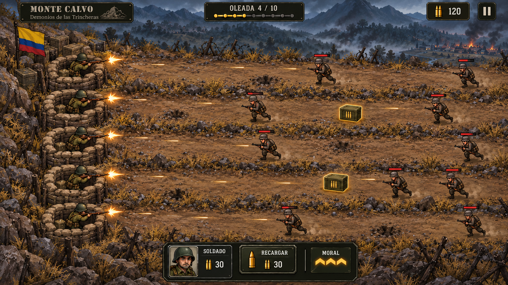

# Referencia visual — Monte Calvo horizontal

El [concepto aprobado](monte-calvo-horizontal-concept.png) se generó con la
herramienta de imagen para esta conversación el 2026-10-19, inspirado en las
referencias facilitadas por la persona. Lo aprobó con «Me gusta, usemos esta
imagen como referencia» y añadió la salida con machete al agotar la munición.
Esta copia es referencia de producto, no una captura de QA ni una entrega jugable.

Orienta cinco filas con trincheras a izquierda y combate hacia la derecha,
montañas azul grisáceo, suelo ocre/oliva, piedra, madera y sacos de arena. El
uniforme oliva, casco, fusil y machete distinguen al colombiano; las poses
finales deben corresponder al disparo dentro y la salida con machete real,
con el tono respetuoso de [SPEC](../../../docs/SPEC.md).

La composición se adapta a tamaños de vista y legibilidad, sin copiar
obligatoriamente perspectiva o dimensiones. No concede cobertura o
invulnerabilidad. Cifras de oleada, munición, costos, barras y controles del
dibujo no fijan balance ni aprueban un HUD. Las decisiones sobre cinco soldados
iniciales, cinco plazas reservadas, salida frontal, regreso tras recarga y
reparto prefijado proceden de las
[aclaraciones expresas de la persona](../spec.md#clarifications), no del dibujo.
El único control añadido por esas decisiones es seleccionar la trinchera y
pulsar «Recargar», mostrando munición y moral individuales del soldado.

No se integrará el concepto entero con actores y controles incrustados como
sustituto del juego. I4 prepara atlas laterales de soldado/enemigo y dos piezas
de trinchera
separadas del terreno, con aprobación funcional para integración T055 en su
rama. La procedencia y el encaje están en los catálogos de
[soldado](../../../assets/sprites/units/monte_calvo/SOURCES.md),
[enemigo](../../../assets/sprites/enemies/monte_calvo/SOURCES.md) y
[entorno](../../../assets/sprites/levels/monte_calvo/SOURCES.md). La revisión
documental final y el PR siguen pendientes; no supone integración en `main`,
aprobación de publicación ni un HUD final.
