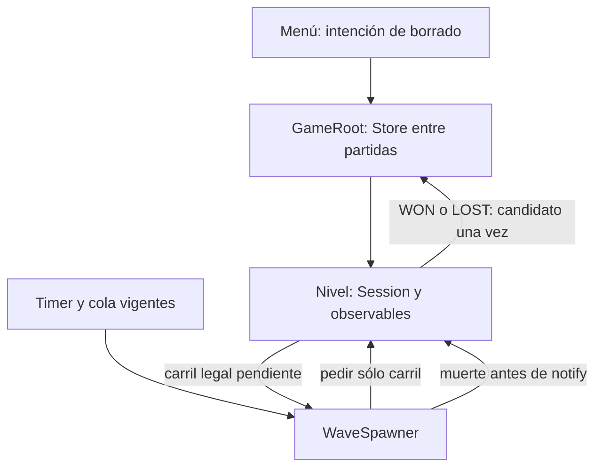

# Implementation Plan: Comandante con memoria — carriles V1

**Feature ID**: `017-comandante-memoria` | **Planned Branch**: `codex/017-i1-comandante-memoria` | **Date**: 2026-10-31 | **Spec**: [spec.md](spec.md)

**Base de I1**: `main` / `e8407ec`; preparación inspeccionada originalmente sobre `c227982`.
**Tracking**: [Issue #65](https://github.com/Juanpvivas/demons/issues/65).
**Input**: tipos, cantidades y tiempos actuales; sólo carriles variables, bloques
globales de cinco sin repetir y memoria local borrable que aprende de WON/LOST.
**Estado**: ejecución de I1 autorizada; QA de preparación independiente aprobada,
implementación/pruebas pendientes de sus gates. La feature016
conserva T009–T011 pendientes y su Issue #63, sin cierre por preparar017.

## Summary

Añadir dos servicios locales instanciables: `CommanderSession` decide carriles y
acumula observaciones; `CommanderMemoryStore` valida y conserva experiencia.
Un `CommanderConfig` inmutable autora los parámetros. Reutilizar GameRoot, nivel,
WaveSpawner y menú existentes; no añadir autoload, Timer, IA individual o red.

Cada WAVE ocupa un carril pendiente del bloque global. Su elección mezcla azar
propio con una preferencia contextual acotada. La memoria queda congelada durante
la partida y sólo se actualiza al recibir un terminal verdadero, usando resultados
WAVE cerrados; abandono descarta todo. Nunca modifica stats, tipos, intervalos,
transiciones de oleada ni el R inicial central. El límite permite dos apariciones
seguidas en un carril entre bloques y no limita cuántos siguen vivos: requiere
validación de equilibrio, aunque conserve cantidades.

Documentación de diseño: [investigación](research.md), [modelo](data-model.md),
[contrato](contracts/commander.md) y [validación futura](quickstart.md).
Este plan termina antes de tareas y ejecución de agentes de implementación.

## Technical Context

**Language/Version**: GDScript, Godot4.7.1 fijado en CI; sin cambio de motor.
**Primary Dependencies**: RefCounted, Resource, RandomNumberGenerator, JSON,
FileAccess/HashingContext y señales existentes; GUT9.7.1 ya instalado.
**Storage**: dos JSON dedicados en user://, cada uno ≤128KiB, esquema1; hasta360
celdas. Modo transitorio explícito si no hay persistencia disponible.
**Testing**: GUT existente bajo tests/unit, runner tools/ci/run_gut.py y CI
vigente. Sólo diseñados en esta fase; ninguna prueba o build ejecutada.
**Target Platform**: Web sólo computador; Android/iOS apps instaladas; PC nativo
para desarrollo. No navegadores móviles ni nuevo SDK o dependencia .NET.
**Project Type**: juego2D compartido y offline.
**Performance Goals**: conservar60FPS constitucionales; máximo99 decisiones y
registros WAVE por partida, máximo5 candidatos por decisión y360 celdas por
consolidación. Sin observador por frame, I/O durante combate o reactivar006.
**Constraints**: A,A,R continuo y tabla del spec; Timer/primer spawn intactos;
INITIAL excluido; sólo terminal aprende; no publicación o excepción beta nueva.
**Scale/Scope**: Monte Calvo actual, diez oleadas,99 WAVE+1 INITIAL,19 bloques
completos+4 finales. Control de borrado en menú y feedback de errores.

## Constitution Check

Evaluación documental antes de investigación y repetida tras el diseño:

| Principio | Comprobación previa | Resultado del diseño |
|---|---|---|
| I — balance como datos | nuevos parámetros separados de lógica | CommanderConfig.tres inmutable; no se editan stats/waves actuales; memoria sólo datos de usuario |
| II — testing y balance | comportamiento nuevo requiere TDD y playtest | setup mínimo si falta API→tester RED→dev→tester GREEN/regresión→QA→docs; protocolo manual de equilibrio definido |
| III — UX | semántica compartida, estados comunicados | menú con intención/confirmación/feedback, foco y safe area; guardado fallido no bloquea jugar |
| IV — rendimiento | preservar pooling y60FPS | selector/eventos acotados sin sondeo por frame; publicación requiere medición física, sin extrapolar CI o reabrir006 |
| V — gates separados | preparar no autoriza integrar/distribuir | futuros builds/CI y QA de integración por SHA; publicación/artefacto/hardware pendientes separados |

No se identifica excepción constitucional necesaria en el diseño. Esto **no es**
un APROBADO de qa-validator ni una medición. Un fallo real de fuente/build,
regresión o equilibrio bloquea integración. #61/#53 y pendientes físicos de otras
features permanecen intactos; las excepciones beta no cubren esta feature.

## Project Structure

### Documentation (this feature)

```text
specs/017-comandante-memoria/
├── spec.md
├── plan.md
├── research.md
├── data-model.md
├── contracts/commander.md
├── quickstart.md
├── tasks.md
└── checklists/requirements.md
```

`tasks.md` fue generado en la etapa posterior de preparación, sin ejecutar tareas.
No guardar logs, capturas o archivos nuevos de evidencias en Git.

### Source Code (repository root, cambios previstos, no realizados)

```text
core/commander_session.gd                        # nuevo: decisión/buffer/aprendizaje
core/commander_memory_store.gd                   # nuevo: validación/slots/borrado
resources/schemas/commander_config.gd            # nuevo: molde tipado de parámetros
resources/director/monte_calvo_commander.tres     # nuevo: valores iniciales
scenes/game/game_root.gd                        # almacén e inyección, permiso de borrado
scenes/levels/nivel_monte_calvo.gd               # observables, terminal y abandono
scenes/levels/wave_spawner.gd                    # elección lane y registro antes de notify
scenes/ui/main_menu.gd                          # intención/estado y foco
scenes/ui/MainMenu.tscn                         # botón, confirmación y feedback
tests/unit/systems/test_commander_session.gd     # futuro: selector/aprendizaje
tests/unit/systems/test_commander_memory_store.gd
tests/unit/levels/test_horizontal_wave_spawner.gd
tests/unit/levels/test_commander_integration.gd
tests/unit/game/test_game_root.gd
tests/unit/ui/test_main_menu.gd
```

**Structure Decision**: servicios RefCounted instanciables, sin árbol propio:
la sesión no necesita frame/timers. Config Resource sólo datos; los nodos dueños
hacen observación/cableado. Reutilizar las suites reales de raíz/menú bajo su
ubicación existente; nombres nuevos de pruebas son previstos.
No modificar project.godot, export_presets.cfg, CI/distribución, Enemigo,
Soldado, WaveManager, GameStateManager o recursos de oleadas por esta V1.

## Arquitectura y contratos decisivos



- Antes de añadir nivel al árbol, la raíz inyecta Store y seed. Nivel directo
  de desarrollo usa almacenamiento transitorio: no escribe memoria real del usuario.
- El contexto candidato contiene fase3×tipo2×carril5×defensa4×carga3=360 claves.
  Observar snapshots públicos; sin moral, economía o futuras órdenes privadas.
- Pesos de memoria en[0.75,1.25], mezcla uniforme0.25: todas las opciones legales
  tienen probabilidad positiva y razón de probabilidades≤5/3. No elige usado.
- Resultado por muerte: avance observado normalizado entre entrada y defensa;
  cruce confirmado=1. Vivos al terminal censurados, sin crédito. Media por celda
  y partida; aprendizaje0.15, retención0.98 y confianza hasta20.
- Configuración, contenido y geometría producen compatibility_id; cambios
  incompatibles reinician memoria. Los valores iniciales requieren QA/playtest.
- Registrar la baja antes de notify_enemy_defeated; cruce antes del reporte
  terminal. Consolidar en game_won/game_lost, nunca MENU/close_match/Retry.
- Store escribe slot inactivo, verifica y sólo entonces publica; borrar ambos
  slots impide recuperar historia vieja. No tocar intro_progress.cfg.
- Web exige prueba de recarga; OK local y OS.is_userfs_persistent no certifican
  durabilidad. Un único escritor por raíz; no sincronizar pestañas/dispositivos.

## Secuencia de entrega futura

| Incremento propuesto | Resultado completo y límites | Skills durante ejecución |
|---|---|---|
| I1: núcleo aislado | config, selector, actualización y Store con RED/GREEN/QA propios; todavía no controla el nivel ni entrega el comandante jugable | resource-pattern, save-load, godot-testing, godot-code-review |
| I2: integración jugable | inyección, spawner, ciclo terminal/abandono, borrado y feedback; regresión, playtest, docs, CI/QA finales | event-bus, godot-ui, responsive-ui, resource-pattern, save-load, godot-testing, godot-code-review |

El orquestador asignará IDs/dependencias y rama por incremento al crear tareas,
con un Issue único. I1 no entrega un PR funcional de gameplay con RED pendiente:
termina su módulo interno probado; el alcance jugable completo depende de I2.
Cada incremento usa tester→dev→tester→QA→docs y PR borrador. Nunca fusionar
ni publicar automáticamente. Nuevos tipos importables pueden requerir setup
neutro mínimo separado para que RED falle por conducta y no por import/parser.

## Verificación y preparación posterior

[quickstart.md](quickstart.md) fija oráculos matemáticos, semillas0–255, límites,
pruebas de orden de señales y matriz funcional de destino. Playtesting planificado:
12 partidas comparables con semillas42/43/44, dos estilos y memoria neutral o
acumulada genuina. Es una evaluación descriptiva, no tasa de victoria poblacional.
El mínimo de victoria por condición y criterios de rechazo se fijan allí antes
de ejecutar. Todo gate sigue pendiente hasta disponer de evidencia real.

La etapa posterior ha generado [tasks.md](tasks.md); su análisis de consistencia
es de sólo lectura y se presenta en conversación, sin archivos de evidencia.
Después corresponde revisar preparación y sólo con autorización de ejecución
entregar al project-orchestrator
`/implementar-feature 017-comandante-memoria` o su equivalente en esta herramienta.
No se inicia ese flujo desde esta preparación. No hay hooks before_plan/after_plan
configurados en `.specify/extensions.yml` en la revisión inspeccionada.

## Complexity Tracking

Sin violaciones constitucionales previstas. Dos servicios y un Resource cubren
selección, estado y persistencia; sin framework de IA, backend, EventBus global,
telemetría externa o subsistema genérico de guardado. Los dos slots y checksum
responden a recuperación tras escritura incompleta, no a una garantía de fsync
multiplataforma ni protección contra manipulación del usuario.
